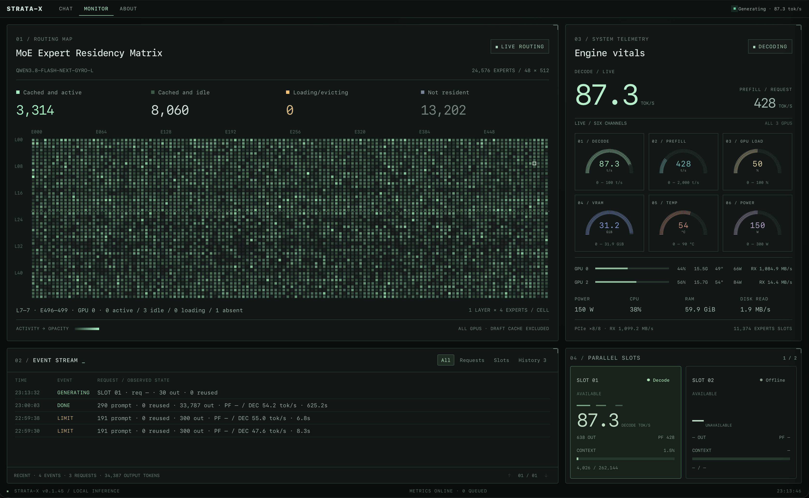

# Strata-X

Fork of upstream Strata, pinned at 0.1.45 (`477ac13c`), carrying the changes this one server needs to serve a 108 GB Qwen3.8-Flash-Next pack from two 16 GB cards plus a shared 8 GB card. Each change sits in its own commit with its own notes, so moving to a newer upstream is a short replay list instead of a private-tree excavation.

The engine keeps upstream defaults wherever it can. The choices that make this deployment what it is are opt-in flags, and they are set by the serving config shown below rather than compiled in.

## TL;DR

What this branch adds on top of 0.1.45, one feature per commit:

| Feature | Commit | What it does here |
|---|---|---|
| Adaptive MTP draft depth | `3ad15d54` | Per-request draft depth inside 3–6: grow above 80% acceptance over three MTP-only rounds, shrink below 65%. Bound fixes in `55be5e30`, solo decode support in `71632713` and `44099cd9`. |
| Shared ngram-mod pool | `05c5a841` | One 16 MiB CPU pool of 24-token matches, shared by both slots and sessions, clipped to the MTP window. Costs no VRAM. |
| Conversation cache in serving | `3100c139`, `22c339ec`, `20b42ee4` | The 8 GiB RAM conversation cache is exposed in serving settings, parked conversations persist to disk, and split-stage images survive a park. |
| STRATA-X console | `780067d0` + `2e26209a`, `467dbf03`, `3a3efbf2`, `18f6dc64`, `11a02d7b`, `936e19d5` | `/monitor` page: request timeline, per-slot state, per-GPU PCIe links, and an opt-in MoE residency matrix fed by `ER` frames from the engine. |
| Light-expert CPU preference | `5576b481`, `5bf02bb8` | Place the smallest expert blobs in host RAM (`--light-expert-max-mib` accepts fractions). Measured slower on this TQ3 pack, so it ships off. |
| INT8 rotated KV default | `35b27733` | Serving default becomes `STRATA_KV_ROT=1` with `--kv int8`. This deployment currently runs `fp16` by choice; the commit stays for the machines that want the halved footprint. |
| Trellis expert formats | `8a209c27`, `88d879f6`, `e923a737`, `2ffb4cf7`, `e590b06c` | TQP5/TQP6/TQP7 (`ggml` types 143–149) on AVX2, AVX-512 and CUDA, the Hadamard rotation wired into the verify and prefill gather paths, and the prompt-arena accounting that keeps large chunks from silently falling back to 512 tokens. |

## This server

| | |
|---|---|
| Host | Debian 13, 2× Xeon E5-2683 v4 (64 threads), 105 GB RAM, 2 NUMA nodes |
| Text GPUs | GPU 0 and GPU 2, RTX 5060 Ti 16 GB each, CUDA order `0,2,1` |
| Auxiliary GPU | GPU 1, RTX 3060 Ti 8 GB, shared: vision encoder plus other services |
| Model | `qwen3.8-flash-next-gyro-l`, 108 GB: Strata pack with Trellis TQP5/6/7 experts, native head GGUF, 48 layers, 512 experts, 24,576 expert pairs in the frozen profile |
| Context | 262,144 tokens (native; no YaRN scaling) |
| Service | `strata.service` on port 8080: `/v1` (OpenAI-compatible), `/health`, `/metrics`, `/monitor` |
| Engine | `/root/Strata/releases/parallel-20261004/engine/strata` |
| Weights | `/srv/qwen38-models/strata-gyro-l-20261016` |

## Configuration

The live argv, 56 items, grouped by what it controls.

| Group | Flags |
|---|---|
| Weights | `--pack /srv/qwen38-models/strata-gyro-l-20261016/pack` `--native …/Qwen3.8-Flash-Next-Gyro-L-TQ3_0.gguf` `--ple-gguf …/Qwen3.8-Flash-Next-Gyro-L-TQ3_0.gguf` `--expert-profile /root/Strata/Strata-tq3-switch-20261018/frozen-profile.bin` `--expert-cache auto` `--prefill auto:16384` |
| Context and KV | `--max-context 262144` `--kv fp16` `--kv-resident 32768` |
| Speculation | `--spec 7` `--mtp-max-t 7` `--mtp /root/Strata/Strata-data/mtp/rt` `--batch-mtp` `--mtp-adaptive` `--spec-min-p 0.70` |
| Caches | `--conversation-cache-mib 8192` `--conversation-cache-slots 64` `--conversation-cache-min-free-mib 2560` `--prefix-cache-dir …/prefix-strata-x-tq3` `--prefix-cache-mib 10240` `--prefix-cache-host-mib 2048` |
| GPU and vision | `--vision` `--vram-reserve-mib 850` `--vram-reserve-later-mib 900` `--pcie-frac 0.15` `--pcie-mode auto` `--trim-stage-weights` |
| Scheduling | `--pool-workers 23` `--batch 1` `--batch-groups 1` |

Environment:

| Variable | Value | Why |
|---|---|---|
| `CUDA_VISIBLE_DEVICES` | `0,2,1` | Both 5060 Ti first, 3060 Ti last so the vision encoder and its reserve land there. |
| `STRATA_PREFILL_CPU_SHARE` | `auto` | Share short prompt chunks with the CPU. Took 18–30% off TTFT on short and medium prompts, neutral past ~3K tokens. `auto` derives the share per layer; `0` turns it off. |

## What we measured

Single server, batch 1, fresh prefixes unless stated. These are fixtures, not a benchmark suite.

| Case | Result |
|---|---|
| Prefill, 32,579 tok | 1,741 tok/s (347 tok/s before the arena accounting fix in `2ffb4cf7`) |
| Prefill, 16,019 tok | 1,317 tok/s |
| Prefill, 2,158 tok | 408 tok/s, 521 with `STRATA_PREFILL_CPU_SHARE=auto` |
| Prefill, 187 tok | 222 tok/s |
| First token, 186-token cold prompt | 1.52 s (1.79 s without the CPU share) |
| First token, 8-step tool loop, warm | 0.99 s median; first SSE event 7–27 ms |
| Decode, 300 tok | 48–57 tok/s |
| MTP acceptance, live counters | 249 of 356 drafts (69.9%) |
| Final adaptive depth | 6 on 240 of 303 requests (79%), 5 on 12%, 4 on 6%, 3 on 3% |
| KV streaming | 32,768 of 262,144 cells in VRAM, 2.50 GiB pinned host copy |

Caveats worth keeping in view: the CPU share trades a little quality for latency (KL ≈ 0.004 in the offline check), no matched IQ3-vs-TQ3 quality or speed run exists yet, and the decode spread above is two-to-three samples per configuration.

## Build

The pack formats need the pinned ggml tree, same as the engine build:

```sh
cmake -S . -B build-tq -DCMAKE_BUILD_TYPE=Release \
  -DCMAKE_CUDA_ARCHITECTURES="86;120" \
  -DCMAKE_CUDA_COMPILER=/usr/local/cuda-13.2/bin/nvcc \
  -DSTRATA_GGML_DIR=/root/Strata/agention-llama
cmake --build build-tq -j
```

Tests that cover the fork's changes:

```sh
ctest --test-dir build-tq -R 'adaptive_mtp_test|ngram_mod_test|native_hadamard_test|native_expert_parity_hadamard|tq_cpu_parity'
```

`tq_cpu_parity` runs about a minute per variant; the Hadamard parity set runs several minutes and is the one that gates a TQ pack.

## Running

```sh
systemctl status strata
journalctl -u strata -f
curl -s localhost:8080/health
curl -s localhost:8080/metrics | python3 -m json.tool | less
```

The engine reads `/root/Strata/releases/parallel-20261004/config.json` (argv in `args`, environment in `env`). Restart the service after editing it; the process reports its loaded state through `/health` and the arguments it actually accepted through `/metrics`.

`/metrics` is the stats surface we use: totals since start, per-request rows with `drafts_offered`/`drafts_accepted`, conversation-cache counters, per-GPU hardware, the slot list, and the expert residency map.

## Branch layout

`main` is this branch. Feature commits sit directly on the upstream tag, ordered so each one applies alone. When a new upstream release lands, replay them in order, keep the ones whose behaviour still matters, and drop the ones upstream solved differently. `docs/TRELLIS.md` covers the pack formats and the rotation contract; the report for this deployment lives in the workspace at `docs/reports/2026-10-19-strata-x.md`.

## License

MIT, inherited from upstream Strata (Copyright 2026 Niko1221 and the Strata contributors).
